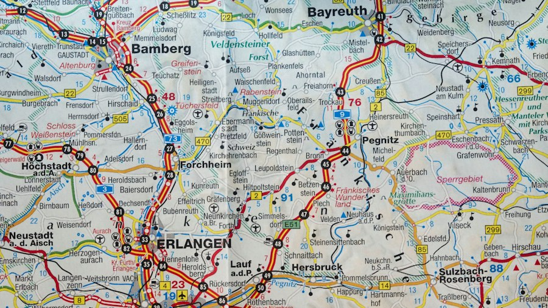

  

::: {.course-meta-box}
::: {.meta-item}
::: {.meta-item-title}
Categoria
:::
::: {.meta-item-val}
Geoprocessamento
:::
:::

::: {.meta-item}
::: {.meta-item-title}
Carga Horária
:::
::: {.meta-item-val}
<i class="bi bi-clock-fill text-primary"></i> 15 horas
:::
:::

::: {.meta-item}
::: {.meta-item-title}
Dedicação Sugerida
:::
::: {.meta-item-val}
<i class="bi bi-calendar3 text-primary"></i> 4 semanas
:::
:::

::: {.meta-item}
::: {.meta-item-title}
Nível
:::
::: {.meta-item-val}
<i class="bi bi-bar-chart-fill text-primary"></i> Intermediário
:::
:::

::: {.meta-item}
::: {.meta-item-title}
Certificação
:::
::: {.meta-item-val}
<i class="bi bi-patch-check-fill text-success"></i> UFSC (Gratuito)
:::
:::
:::

::: {.cta-banner}

  <h4 class="mb-1" style="color: #0c4a6e; font-weight: 700;">Leve o território para o centro da sua tomada de decisão</h4>
  
Aprenda a criar mapas epidemiológicos no R com dados oficiais do SUS e malhas do IBGE.

  <a href="https://inscricoes.ufsc.br/activities/9903" target="_blank" class="btn btn-action-cert">
    <i class="bi bi-award-fill"></i> Inscrição com Certificado (UFSC)
  </a>
  <a href="https://grupos.moodle.ufsc.br/course/view.php?id=3905" target="_blank" class="btn btn-action-moodle">
    <i class="bi bi-unlock-fill"></i> Acessar Moodle Livre
  </a>

:::

## Apresentação do Curso

Neste curso aprofundaremos as análises de bancos de dados de saúde construindo mapas de interesse epidemiológico. Na Vigilância em Saúde utilizamos o geoprocessamento como uma ferramenta fundamental que permite a análise da distribuição espacial de determinadas doenças, eventos e agravos relacionados à saúde.

Ao produzir mapas temáticos que colorem ou sombreiam um conjunto de áreas territoriais de acordo com seus valores, taxas ou coeficientes, estamos construindo um mapa epidemiológico. Com ele você poderá identificar, localizar, acompanhar e monitorar populações de maneira a direcionar as ações de Vigilância em Saúde para que sejam executadas com maior efetividade, equidade e assertividade!

---

## O que você vai aprender

Ao final deste curso, você será capaz de:

* <i class="bi bi-check2-circle text-success"></i> **Conceitos fundamentais de cartografia e geoprocessamento:** Sistemas de coordenadas, projeções cartográficas e tipos de feições (pontos, linhas, polígonos).
* <i class="bi bi-check2-circle text-success"></i> **Manipulação de dados espaciais no R:** Utilizar pacotes modernos como `sf` (simple features) e `geobr` para download de malhas oficiais do IBGE.
* <i class="bi bi-check2-circle text-success"></i> **Cruzamento de dados epidemiológicos com malhas territoriais:** Associar bancos do DATASUS às geometrias municipais e de bairros por meio do código IBGE.
* <i class="bi bi-check2-circle text-success"></i> **Mapas coropléticos:** Configurar quebras de classe (quantis, intervalos iguais, desvios), paletas de cores perceptualmente uniformes e legendas informativas.
* <i class="bi bi-check2-circle text-success"></i> **Mapas de pontos:** Plotar casos georreferenciados ou estabelecimentos de saúde no território.

---

::: {.callout-note appearance="simple"}
### Preparação Recomendada
Para seguir com este curso você deve conhecer as ferramentas básicas para uso da linguagem R e do RStudio, além de possuir conhecimentos básicos de rotinas de análises de dados. Caso você ainda não tenha contato prévio com o R, recomendamos iniciar pelo [Análise de Dados para a Vigilância em Saúde – Curso Básico](curso-basico.qmd), que é 100% gratuito e apresenta todo o passo a passo inicial.
:::

::: {.d-flex .justify-content-center .gap-3 .mt-4 .mb-5 .flex-wrap}
<a href="https://inscricoes.ufsc.br/activities/9903" target="_blank" class="btn btn-action-cert px-4 py-2">
  <i class="bi bi-award-fill"></i> Inscreva-se com Certificado UFSC
</a>
<a href="https://grupos.moodle.ufsc.br/course/view.php?id=3905" target="_blank" class="btn btn-action-moodle px-4 py-2">
  <i class="bi bi-unlock-fill"></i> Entrar no Moodle Livre
</a>
:::
