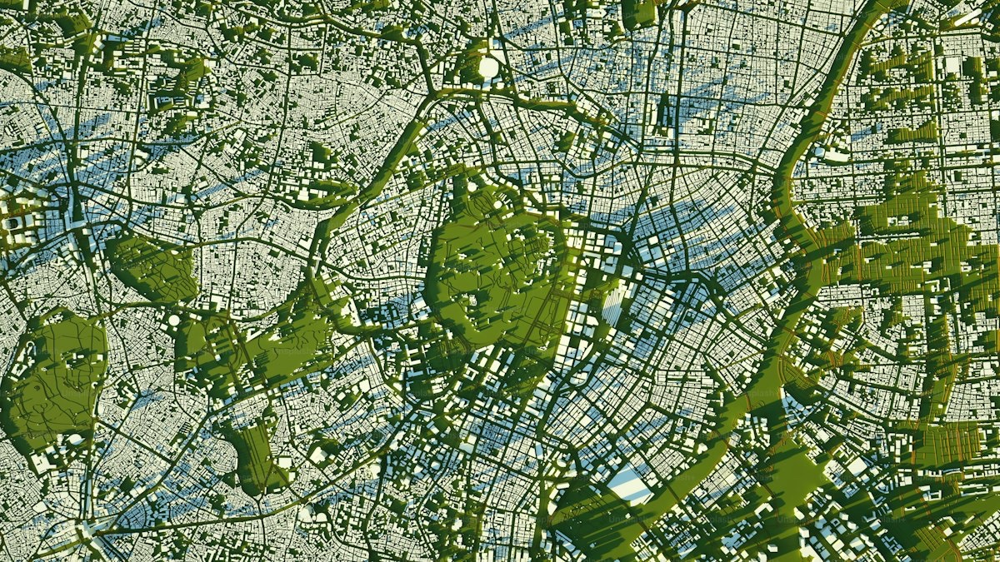

  

::: {.course-meta-box}
::: {.meta-item}
::: {.meta-item-title}
Categoria
:::
::: {.meta-item-val}
Geoprocessamento
:::
:::

::: {.meta-item}
::: {.meta-item-title}
Carga Horária
:::
::: {.meta-item-val}
<i class="bi bi-clock-fill text-primary"></i> 15 horas
:::
:::

::: {.meta-item}
::: {.meta-item-title}
Dedicação Sugerida
:::
::: {.meta-item-val}
<i class="bi bi-calendar3 text-primary"></i> 4 semanas
:::
:::

::: {.meta-item}
::: {.meta-item-title}
Nível
:::
::: {.meta-item-val}
<i class="bi bi-bar-chart-fill text-primary"></i> Intermediário
:::
:::

::: {.meta-item}
::: {.meta-item-title}
Certificação
:::
::: {.meta-item-val}
<i class="bi bi-patch-check-fill text-success"></i> UFSC (Gratuito)
:::
:::
:::

::: {.cta-banner}

  <h4 class="mb-1" style="color: #0c4a6e; font-weight: 700;">Leve o território para o centro da sua tomada de decisão</h4>
  
Aprenda a criar mapas epidemiológicos no R com dados oficiais do SUS e malhas do IBGE.

  <a href="https://inscricoes.ufsc.br/activities/9903" target="_blank" class="btn btn-action-cert">
    <i class="bi bi-award-fill"></i> Inscrição com Certificado (UFSC)
  </a>
  <a href="https://grupos.moodle.ufsc.br/course/view.php?id=3905" target="_blank" class="btn btn-action-moodle">
    <i class="bi bi-unlock-fill"></i> Acessar Moodle Livre
  </a>

:::

## Apresentação do Curso

O território é onde a vida acontece e onde os agravos à saúde se manifestam. Na vigilância em saúde, o geoprocessamento é uma ferramenta essencial que permite analisar a distribuição espacial de doenças, identificar disparidades geográficas de acesso e orientar intervenções com maior efetividade e equidade.

Ao produzir mapas temáticos que colorem áreas territoriais de acordo com taxas, coeficientes ou contagens de casos, transformamos tabelas frias em diagnósticos visuais imediatos. Neste curso, você aprenderá a reconhecer dados espaciais nos sistemas do SUS, manipular malhas geográficas no R e construir mapas epidemiológicos de alto impacto profissional, sem depender de softwares proprietários ou rotinas manuais demoradas.

---

## O que você vai aprender

O curso está organizado em **4 módulos estruturados**, orientados à produção prática de cartografia em saúde:

* <i class="bi bi-check2-circle text-success"></i> **Geoprocessamento para a vigilância em saúde (Seção 1):** compreender a evolução e os princípios do geoprocessamento em saúde pública e a importância da visualização espacial na gestão de políticas sanitárias.
* <i class="bi bi-check2-circle text-success"></i> **O dado espacial na vigilância (Seção 2):** reconhecer as fontes de dados espaciais da saúde (endereços, municípios de notificação e residência, setores censitários), seus níveis de agregação e a classificação de feições vetoriais (pontos, linhas e polígonos).
* <i class="bi bi-check2-circle text-success"></i> **Composição cartográfica e importação no R (Seção 3):** dominar elementos básicos do mapa (título, legenda, escala e orientação), teoria das cores aplicadas à epidemiologia, transformação de sistemas de referência de coordenadas (CRS/SIRGAS 2000) e visualização com função base `plot()` e pacote `ggplot2`.
* <i class="bi bi-check2-circle text-success"></i> **União de bases tabulares com bases geográficas (Seção 4):** cruzar tabelas de dados do DATASUS com malhas digitais do IBGE por meio de geocódigos municipais, gerando mapas coropléticos e mapas de pontos para boletins e apresentações institucionais.

---

::: {.callout-note appearance="simple"}
### Preparação Recomendada
Para seguir com este curso você deve conhecer as ferramentas básicas para uso da linguagem R e do RStudio, além de possuir conhecimentos básicos de rotinas de análises de dados. Caso você ainda não tenha contato prévio com o R, recomendamos iniciar pelo [Análise de Dados para a Vigilância em Saúde – Curso Básico](curso-basico.qmd), que é 100% gratuito e apresenta todo o passo a passo inicial.
:::

::: {.d-flex .justify-content-center .gap-3 .mt-4 .mb-5 .flex-wrap}
<a href="https://inscricoes.ufsc.br/activities/9903" target="_blank" class="btn btn-action-cert px-4 py-2">
  <i class="bi bi-award-fill"></i> Inscreva-se com Certificado UFSC
</a>
<a href="https://grupos.moodle.ufsc.br/course/view.php?id=3905" target="_blank" class="btn btn-action-moodle px-4 py-2">
  <i class="bi bi-unlock-fill"></i> Entrar no Moodle Livre
</a>
:::
