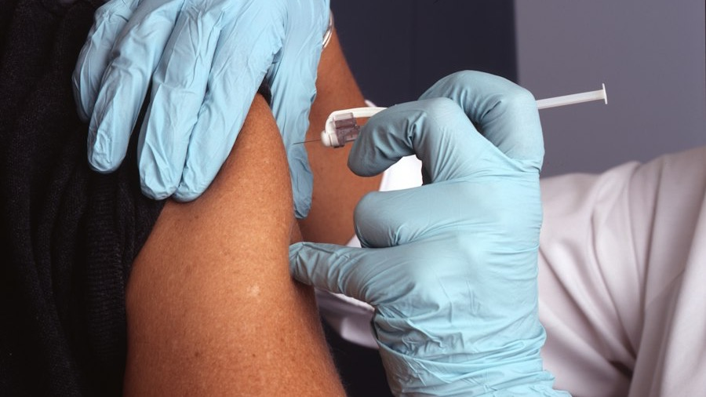

  

::: {.course-meta-box}
::: {.meta-item}
::: {.meta-item-title}
Status
:::
::: {.meta-item-val}
Novo Lançamento
:::
:::

::: {.meta-item}
::: {.meta-item-title}
Carga Horária
:::
::: {.meta-item-val}
<i class="bi bi-clock-fill text-primary"></i> 15 horas
:::
:::

::: {.meta-item}
::: {.meta-item-title}
Dedicação Sugerida
:::
::: {.meta-item-val}
<i class="bi bi-calendar3 text-primary"></i> 4 semanas
:::
:::

::: {.meta-item}
::: {.meta-item-title}
Nível
:::
::: {.meta-item-val}
<i class="bi bi-bar-chart-fill text-primary"></i> Intermediário
:::
:::

::: {.meta-item}
::: {.meta-item-title}
Certificação
:::
::: {.meta-item-val}
<i class="bi bi-patch-check-fill text-success"></i> UFSC (Gratuito)
:::
:::
:::

::: {.cta-banner}

  <h4 class="mb-1" style="color: #0c4a6e; font-weight: 700;">Promova a equidade na sua análise de dados em saúde</h4>
  
Aprenda a estratificar indicadores por determinantes sociais e calcular métricas de desigualdade.

  <a href="https://inscricoes.ufsc.br/activities/12556" target="_blank" class="btn btn-action-cert">
    <i class="bi bi-award-fill"></i> Inscrição com Certificado (UFSC)
  </a>
  <a href="https://grupos.moodle.ufsc.br/course/view.php?id=4877" target="_blank" class="btn btn-action-moodle">
    <i class="bi bi-unlock-fill"></i> Acessar Moodle Livre
  </a>

:::

## Apresentação do Curso

A equidade é um dos princípios doutrinários fundamentais do Sistema Único de Saúde (SUS). No entanto, para que as ações de vigilância e atenção cheguem onde são mais necessárias, é indispensável que a análise de dados seja capaz de evidenciar quem são as populações mais atingidas por agravos evitáveis e onde residem as maiores barreiras de acesso.

O curso **Monitoramento das Desigualdades em Saúde na Vigilância** foi desenvolvido para instrumentalizar profissionais do SUS na mensuração de disparidades sociodemográficas e econômicas. Você aprenderá a sair das médias globais populacionais (que frequentemente mascaram disparidades graves) e a calcular indicadores estratificados com métodos estatísticos consolidados pela epidemiologia social e pela Organização Mundial da Saúde (OMS).

---

## O que você vai aprender

Ao final deste curso, você será capaz de:

* <i class="bi bi-check2-circle text-success"></i> **Fundamentos de determinantes sociais da saúde:** Compreender conceitos de igualdade, desigualdade e iniquidade em saúde.
* <i class="bi bi-check2-circle text-success"></i> **Estratificadores de equidade no SUS:** Manipular variáveis sociodemográficas clássicas (raça/cor da pele, escolaridade, sexo, zona de residência, quintis de renda e vulnerabilidade territorial).
* <i class="bi bi-check2-circle text-success"></i> **Medidas simples de desigualdade:** Calcular razões de taxas e diferenças absolutas de taxas entre grupos extremos.
* <i class="bi bi-check2-circle text-success"></i> **Medidas complexas de gradiente social:** Compreender e calcular índices de gradiente, tais como o Índice de Declive de Desigualdade (*Slope Index of Inequality* - SII) e o Índice Relativo de Desigualdade (*Relative Index of Inequality* - RII).
* <i class="bi bi-check2-circle text-success"></i> **Visualização de desigualdades:** Construir gráficos de equidade (gráficos equiplot, curvas de Lorenz, gradientes de concentração) no R com o `ggplot2`.
* <i class="bi bi-check2-circle text-success"></i> **Elaboração de recomendações para a gestão:** Traduzir achados de disparidade em propostas de intervenção e priorização de recursos para a Atenção Primária e Vigilância.

---

::: {.callout-note appearance="simple"}
### Preparação Recomendada
Para seguir com este curso você deve conhecer as ferramentas básicas para uso da linguagem R e do RStudio, além de possuir conhecimentos básicos de rotinas de análises de dados. Caso você ainda não tenha contato prévio com o R, recomendamos iniciar pelo [Análise de Dados para a Vigilância em Saúde – Curso Básico](curso-basico.qmd), que é 100% gratuito e apresenta todo o passo a passo inicial.
:::

::: {.d-flex .justify-content-center .gap-3 .mt-4 .mb-5 .flex-wrap}
<a href="https://inscricoes.ufsc.br/activities/12556" target="_blank" class="btn btn-action-cert px-4 py-2">
  <i class="bi bi-award-fill"></i> Inscreva-se com Certificado UFSC
</a>
<a href="https://grupos.moodle.ufsc.br/course/view.php?id=4877" target="_blank" class="btn btn-action-moodle px-4 py-2">
  <i class="bi bi-unlock-fill"></i> Entrar no Moodle Livre
</a>
:::
