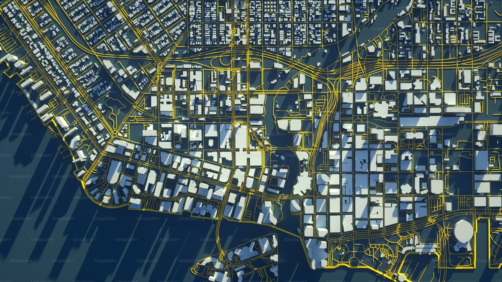

  

::: {.course-meta-box}
::: {.meta-item}
::: {.meta-item-title}
Status
:::
::: {.meta-item-val}
Novo Lançamento
:::
:::

::: {.meta-item}
::: {.meta-item-title}
Carga Horária
:::
::: {.meta-item-val}
<i class="bi bi-clock-fill text-primary"></i> 45 horas
:::
:::

::: {.meta-item}
::: {.meta-item-title}
Dedicação Sugerida
:::
::: {.meta-item-val}
<i class="bi bi-calendar3 text-primary"></i> 6 semanas
(o aluno pode definir seu tempo de curso, mais rápido ou mais longo que o sugerido)
:::
:::

::: {.meta-item}
::: {.meta-item-title}
Nível
:::
::: {.meta-item-val}
<i class="bi bi-bar-chart-fill text-primary"></i> Avançado
:::
:::

::: {.meta-item}
::: {.meta-item-title}
Certificação
:::
::: {.meta-item-val}
<i class="bi bi-patch-check-fill text-success"></i> UFSC (Gratuito)
:::
:::
:::

::: {.cta-banner}

  <h4 class="mb-1" style="color: #0c4a6e; font-weight: 700;">Modelagem espacial rigorosa para a saúde pública</h4>
  
Aprenda a lidar com o problema das pequenas áreas e a detectar aglomerados de risco no R.

  <a href="https://inscricoes.ufsc.br/activities/12030" target="_blank" class="btn btn-action-cert">
    <i class="bi bi-award-fill"></i> Inscrição com Certificado (UFSC)
  </a>
  <a href="https://grupos.moodle.ufsc.br/course/view.php?id=4714" target="_blank" class="btn btn-action-moodle">
    <i class="bi bi-unlock-fill"></i> Acessar Ambiente Virtual
  </a>

:::

## Apresentação do Curso

Mapas temáticos coropléticos simples são excelentes para comunicação visual, mas frequentemente sofrem de limitações estatísticas severas na epidemiologia — em especial a instabilidade das taxas brutas em áreas com pequenas populações (onde um único caso ou óbito eleva artificialmente o indicador a patamares alarmantes).

O curso **Estatística Espacial aplicada à Vigilância em Saúde** aprofunda os métodos quantitativos para além da simples confecção de mapas descritivos. Você aprenderá a modelar a dependência espacial de agravos no R, aplicar métodos de padrões pontuais e de dados de área, suavizar flutuações amostrais com estimadores bayesianos e identificar conglomerados espaciais (*clusters*) para direcionar com precisão as ações e os recursos de saúde pública no SUS.

---

## O que você vai aprender

O curso está organizado em **5 módulos densos e práticos**, abordando as três grandes vertentes da análise espacial em saúde (padrões pontuais, dados de área e geoestatística):

* <i class="bi bi-check2-circle text-success"></i> **Fundamentos da estatística espacial em saúde (Módulo 1):** compreender a origem e a evolução histórica da análise espacial, as hipóteses de dependência territorial (Primeira Lei da Geografia de Tobler) e os critérios para escolha do método adequado a cada pergunta epidemiológica.
* <i class="bi bi-check2-circle text-success"></i> **Análise de padrões pontuais (Módulo 2):** investigar a distribuição de eventos pontuais no território, testando aleatoriedade espacial completa (CSR), estimando densidades com funções de Kernel com diferentes raios de busca (*bandwidth*) e identificando fontes de contaminação e fatores de exposição.
* <i class="bi bi-check2-circle text-success"></i> **Dados de área e autocorrelação espacial (Módulo 3):** construir matrizes de vizinhança espacial (critérios de contiguidade torre, rainha e k-vizinhos), calcular o Índice Global de Moran ($I$), mapear agrupamentos locais com os Indicadores LISA e aplicar suavização bayesiana empírica para estabilização de taxas em pequenas áreas.
* <i class="bi bi-check2-circle text-success"></i> **Geoestatística e superfícies contínuas (Módulo 4):** modelar variáveis regionalizadas contínuas (como fatores ambientais, climáticos e de poluição), modelando semivariogramas experimentais e teóricos e interpolando superfícies preditivas por krigagem.
* <i class="bi bi-check2-circle text-success"></i> **Dados espaço-temporais na vigilância (Módulo 5):** integrar as dimensões espacial e temporal em análises conjuntas, identificando trajetórias de expansão territorial e persistência de focos de transmissão ao longo das semanas epidemiológicas.

---

::: {.callout-note appearance="simple"}
### Preparação Recomendada
Não há pré-requisitos para você se inscrever nesse curso. No entanto, é importante você conhecer previamente as ferramentas básicas para uso da linguagem R e do RStudio, além de possuir conhecimentos básicos de rotinas de análises de dados. Caso você ainda não tenha contato prévio com o R, recomendamos iniciar pelo [Análise de Dados para a Vigilância em Saúde – Curso Básico](curso-basico.qmd), que é 100% gratuito e apresenta todo o passo a passo inicial.
:::

::: {.d-flex .justify-content-center .gap-3 .mt-4 .mb-5 .flex-wrap}
<a href="https://inscricoes.ufsc.br/activities/12030" target="_blank" class="btn btn-action-cert px-4 py-2">
  <i class="bi bi-award-fill"></i> Inscreva-se com Certificado UFSC
</a>
<a href="https://grupos.moodle.ufsc.br/course/view.php?id=4714" target="_blank" class="btn btn-action-moodle px-4 py-2">
  <i class="bi bi-unlock-fill"></i> Entrar no Ambiente Virtual
</a>
:::
