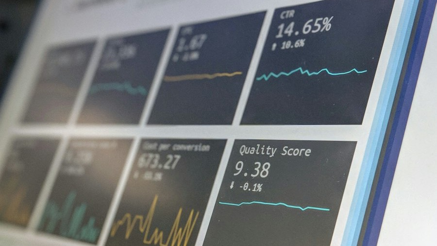

  

::: {.course-meta-box}
::: {.meta-item}
::: {.meta-item-title}
Status
:::
::: {.meta-item-val}
Novo Lançamento
:::
:::

::: {.meta-item}
::: {.meta-item-title}
Carga Horária
:::
::: {.meta-item-val}
<i class="bi bi-clock-fill text-primary"></i> 45 horas
:::
:::

::: {.meta-item}
::: {.meta-item-title}
Dedicação Sugerida
:::
::: {.meta-item-val}
<i class="bi bi-calendar3 text-primary"></i> 6 semanas
:::
:::

::: {.meta-item}
::: {.meta-item-title}
Nível
:::
::: {.meta-item-val}
<i class="bi bi-bar-chart-fill text-primary"></i> Avançado
:::
:::

::: {.meta-item}
::: {.meta-item-title}
Certificação
:::
::: {.meta-item-val}
<i class="bi bi-patch-check-fill text-success"></i> UFSC (Gratuito)
:::
:::
:::

::: {.cta-banner}

  <h4 class="mb-1" style="color: #0c4a6e; font-weight: 700;">Domine a dimensão temporal dos dados em saúde pública</h4>
  
Aprenda a aplicar métodos de decomposição, regressão com erros correlacionados e modelos ARIMA.

  <a href="https://inscricoes.ufsc.br/activities/12029" target="_blank" class="btn btn-action-cert">
    <i class="bi bi-award-fill"></i> Inscrição com Certificado (UFSC)
  </a>
  <a href="https://grupos.moodle.ufsc.br/course/view.php?id=4350" target="_blank" class="btn btn-action-moodle">
    <i class="bi bi-unlock-fill"></i> Acessar Moodle Livre
  </a>

:::

## Apresentação do Curso

A dimensão temporal é o coração da vigilância epidemiológica. Na rotina dos serviços de saúde pública, compreender como doenças, internações e óbitos se distribuem ao longo do tempo é indispensável para detectar padrões sazonais (como o aumento de doenças respiratórias no inverno e de arboviroses no verão), identificar desvios precoces na transmissão e orientar planos de contingência de leitos e insumos.

O curso **Análises de Séries Temporais aplicadas à Vigilância em Saúde** oferece uma capacitação densa e prática no software R. Você aprenderá desde os fundamentos de dados longitudinais e decomposição de componentes até métodos de suavização, diagnóstico de estacionariedade, modelos de regressão avançados (como Modelos Aditivos Generalizados — GAM) e projeção de cenários futuros para o SUS.

---

## O que você vai aprender

O curso está organizado em **8 módulos progressivos**, combinando teoria estatística e aplicação direta com dados epidemiológicos reais:

* <i class="bi bi-check2-circle text-success"></i> **Fundamentos e objetivos de séries temporais (Módulo 1):** compreender definições, objetivos e as particularidades de variáveis temporais em saúde pública (frequências diárias, semanas epidemiológicas e mensais).
* <i class="bi bi-check2-circle text-success"></i> **Conceitos fundamentais da análise temporal (Módulo 2):** identificar e caracterizar os quatro componentes clássicos de uma série: tendência de longo prazo, sazonalidade, ciclicidade e variações aleatórias.
* <i class="bi bi-check2-circle text-success"></i> **Estruturação e manipulação prática no R (Módulo 3):** manipular objetos temporais, criar gráficos de linhas de alta qualidade, ajustar escalas de datas e explorar funções básicas de visualização.
* <i class="bi bi-check2-circle text-success"></i> **Transformações e suavizações de dados (Módulo 4):** aplicar técnicas de transformação para estabilização de variância e métodos de suavização (médias móveis e splines) para atenuação de ruídos em séries ruidosas.
* <i class="bi bi-check2-circle text-success"></i> **Introdução à modelagem estatística temporal (Módulo 5):** formular modelos de regressão com variáveis de tempo para estimação de tendências lineares e componentes sazonais em taxas de incidência.
* <i class="bi bi-check2-circle text-success"></i> **Diagnóstico do modelo e qualidade de ajuste (Módulo 6):** avaliar resíduos, identificar autocorrelação residual e utilizar métricas de ajuste para seleção de modelos epidemiológicos parcimoniosos.
* <i class="bi bi-check2-circle text-success"></i> **Modelagem flexível com GAM (Módulo 7):** ajustar Modelos Aditivos Generalizados com o pacote `mgcv`, incorporando funções de suavização não lineares para capturar comportamentos complexos da dinâmica de doenças.
* <i class="bi bi-check2-circle text-success"></i> **Previsão e cenários futuros para a vigilância (Módulo 8):** gerar conjuntos de dados futuros e projetar predições com intervalos de confiança para antecipar demandas sanitárias no SUS.

---

::: {.callout-note appearance="simple"}
### Preparação Recomendada
Para seguir com este curso você deve conhecer as ferramentas básicas para uso da linguagem R e do RStudio, além de possuir conhecimentos básicos de rotinas de análises de dados. Caso você ainda não tenha contato prévio com o R, recomendamos iniciar pelo [Análise de Dados para a Vigilância em Saúde – Curso Básico](curso-basico.qmd), que é 100% gratuito e apresenta todo o passo a passo inicial.
:::

::: {.d-flex .justify-content-center .gap-3 .mt-4 .mb-5 .flex-wrap}
<a href="https://inscricoes.ufsc.br/activities/12029" target="_blank" class="btn btn-action-cert px-4 py-2">
  <i class="bi bi-award-fill"></i> Inscreva-se com Certificado UFSC
</a>
<a href="https://grupos.moodle.ufsc.br/course/view.php?id=4350" target="_blank" class="btn btn-action-moodle px-4 py-2">
  <i class="bi bi-unlock-fill"></i> Entrar no Moodle Livre
</a>
:::
