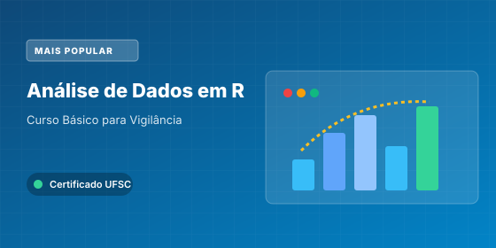
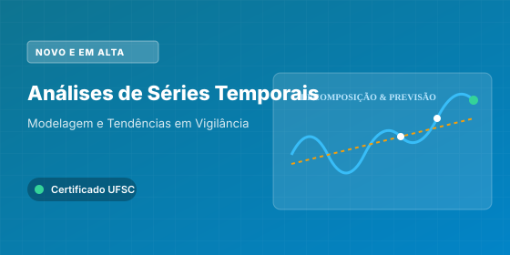
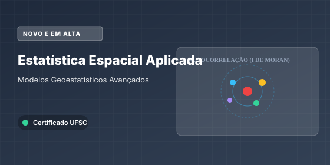
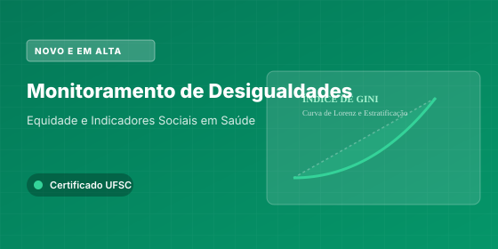
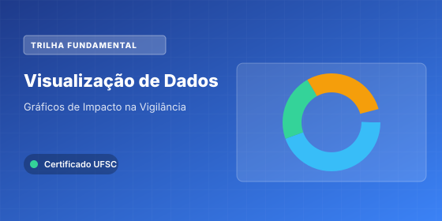
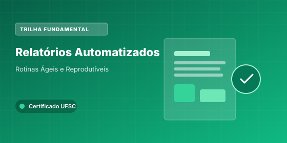
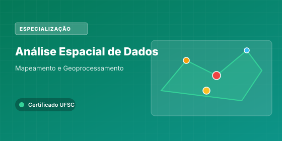
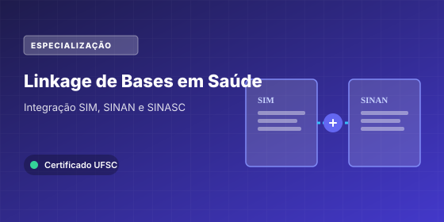
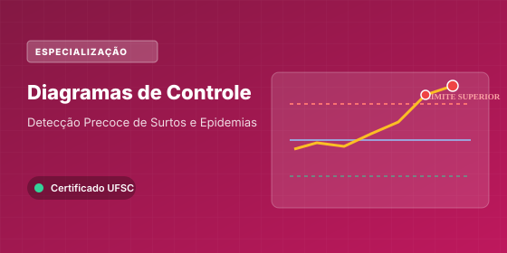

```{=html}
<!-- HERO COMPACTO COM ACESSO IMEDIATO ABOVE THE FOLD -->
<div class="hero-wrapper">
  <div class="hero-content">
    <div class="hero-top-row">
      <div class="hero-title-group">
        <h1 class="hero-title">Cursos Integrados de Vigilância em Saúde</h1>
        <p class="hero-subtitle">
          Qualificação profissional em análise de dados com R para o SUS. 100% gratuito, autoinstrucional e com certificação universitária oficial da UFSC.
        </p>
      </div>
      <div class="hero-actions-compact">
        <a href="#catalogo" class="btn btn-primary-hero">
          <i class="bi bi-grid-3x3-gap-fill"></i> Ver os 10 Cursos
        </a>
        <a href="sobre.html" class="btn btn-secondary-hero">
          <i class="bi bi-info-circle"></i> Sobre o Projeto
        </a>
      </div>
    </div>

    <div class="hero-stats-ribbon">
      <div class="stat-item">
        <div class="stat-number">+40.000</div>
        <div class="stat-label">Profissionais Inscritos em Todo o Brasil</div>
      </div>
      <div class="stat-item">
        <div class="stat-number">10 Cursos</div>
        <div class="stat-label">Módulos Práticos em Linguagem R</div>
      </div>
      <div class="stat-item">
        <div class="stat-number">90% no SUS</div>
        <div class="stat-label">Atuação Direta na Vigilância em Saúde</div>
      </div>
      <div class="stat-item">
        <div class="stat-number">Certificado UFSC</div>
        <div class="stat-label">Extensão Universitária Oficial Gratuita</div>
      </div>
    </div>
  </div>
</div>

<div class="container" style="max-width: 1240px; margin: 0 auto; padding: 0 0.75rem;">

  <div style="margin-top: 1.5rem; margin-bottom: 1.25rem;">
    <h2 id="catalogo" style="font-weight: 800; color: #0e4877; margin: 0 0 0.35rem 0; font-size: 1.45rem; border: none; padding: 0;">
      Catálogo de Cursos
    </h2>
    <p style="color: #64748b; font-size: 0.95rem; margin: 0;">
      Selecione um curso para ver detalhes, ementa completa e realizar sua inscrição gratuita com ou sem emissão de certificado.
    </p>
  </div>

  <!-- GRID DE CURSOS ESTILO COURSERA / UDEMY (4 POR LINHA) -->
  <div class="courses-grid-udemy">

    <!-- CURSO 1: Básico em R -->
    <div class="course-card-udemy">
      <div class="course-card-thumb">
        <span class="badge-udemy badge-popular">Mais Procurado</span>
        <span class="badge-hours-pill"><i class="bi bi-clock"></i> 45h</span>
        <a href="cursos/curso-basico.html">
          
        </a>
      </div>
      <div class="course-card-body">
        <div class="course-card-meta">
          <span class="meta-tag"><i class="bi bi-mortarboard-fill text-primary"></i> Extensão UFSC</span>
          <span class="meta-dot">•</span>
          <span class="meta-tag"><i class="bi bi-check-circle-fill text-success"></i> 45 horas</span>
        </div>
        <h3 class="course-card-title">
          <a href="cursos/curso-basico.html">Análise de Dados para a Vigilância em Saúde – Curso Básico</a>
        </h3>
        <p class="course-card-desc">
          Curso introdutório sobre análise de dados para a vigilância em saúde. No curso serão apresentadas técnicas para gerenciamento de dados na vigilância, análise básica de dados, cálculo de indicadores e sua apresentação gráfica.
        </p>
        <div class="course-card-footer">
          <a href="cursos/curso-basico.html" class="btn-card-primary">
            Ver Curso e Inscrição <i class="bi bi-arrow-right"></i>
          </a>
          <div class="course-card-links-row">
            <a href="https://inscricoes.ufsc.br/activities/9897" target="_blank" title="Inscrição com certificado oficial">
              <i class="bi bi-award"></i> Certificado UFSC
            </a>
            <a href="https://grupos.moodle.ufsc.br/course/view.php?id=3900" target="_blank" title="Acesso livre como visitante com login GOV.br">
              <i class="bi bi-unlock"></i> Moodle Livre
            </a>
          </div>
        </div>
      </div>
    </div>

    <!-- CURSO 2: Séries Temporais -->
    <div class="course-card-udemy">
      <div class="course-card-thumb">
        <span class="badge-udemy badge-new">Novo e em Alta</span>
        <span class="badge-hours-pill"><i class="bi bi-clock"></i> 45h</span>
        <a href="cursos/series-temporais.html">
          
        </a>
      </div>
      <div class="course-card-body">
        <div class="course-card-meta">
          <span class="meta-tag"><i class="bi bi-mortarboard-fill text-primary"></i> Extensão UFSC</span>
          <span class="meta-dot">•</span>
          <span class="meta-tag"><i class="bi bi-check-circle-fill text-success"></i> 45 horas</span>
        </div>
        <h3 class="course-card-title">
          <a href="cursos/series-temporais.html">Análises de Séries Temporais aplicadas à Vigilância em Saúde</a>
        </h3>
        <p class="course-card-desc">
          Conceitos, classificações e aplicações de séries temporais no monitoramento de problemas de saúde ao longo do tempo, com especial aplicação na vigilância em saúde no SUS.
        </p>
        <div class="course-card-footer">
          <a href="cursos/series-temporais.html" class="btn-card-primary">
            Ver Curso e Inscrição <i class="bi bi-arrow-right"></i>
          </a>
          <div class="course-card-links-row">
            <a href="https://inscricoes.ufsc.br/activities/12029" target="_blank">
              <i class="bi bi-award"></i> Certificado UFSC
            </a>
            <a href="https://grupos.moodle.ufsc.br/course/view.php?id=4350" target="_blank">
              <i class="bi bi-unlock"></i> Moodle Livre
            </a>
          </div>
        </div>
      </div>
    </div>

    <!-- CURSO 3: Estatística Espacial -->
    <div class="course-card-udemy">
      <div class="course-card-thumb">
        <span class="badge-udemy badge-new">Novo e em Alta</span>
        <span class="badge-hours-pill"><i class="bi bi-clock"></i> 45h</span>
        <a href="cursos/estatistica-espacial.html">
          
        </a>
      </div>
      <div class="course-card-body">
        <div class="course-card-meta">
          <span class="meta-tag"><i class="bi bi-mortarboard-fill text-primary"></i> Extensão UFSC</span>
          <span class="meta-dot">•</span>
          <span class="meta-tag"><i class="bi bi-check-circle-fill text-success"></i> 45 horas</span>
        </div>
        <h3 class="course-card-title">
          <a href="cursos/estatistica-espacial.html">Estatística Espacial aplicada à Vigilância em Saúde</a>
        </h3>
        <p class="course-card-desc">
          Conceitos, classificações e aplicações de métodos estatísticos na análise de dados georreferenciados, com foco em vigilância em saúde no SUS.
        </p>
        <div class="course-card-footer">
          <a href="cursos/estatistica-espacial.html" class="btn-card-primary">
            Ver Curso e Inscrição <i class="bi bi-arrow-right"></i>
          </a>
          <div class="course-card-links-row">
            <a href="https://inscricoes.ufsc.br/activities/12030" target="_blank">
              <i class="bi bi-award"></i> Certificado UFSC
            </a>
            <a href="https://grupos.moodle.ufsc.br/course/view.php?id=4714" target="_blank">
              <i class="bi bi-unlock"></i> Moodle Livre
            </a>
          </div>
        </div>
      </div>
    </div>

    <!-- CURSO 4: Monitoramento das Desigualdades -->
    <div class="course-card-udemy">
      <div class="course-card-thumb">
        <span class="badge-udemy badge-new">Novo e em Alta</span>
        <span class="badge-hours-pill"><i class="bi bi-clock"></i> 15h</span>
        <a href="cursos/desigualdades.html">
          
        </a>
      </div>
      <div class="course-card-body">
        <div class="course-card-meta">
          <span class="meta-tag"><i class="bi bi-mortarboard-fill text-primary"></i> Extensão UFSC</span>
          <span class="meta-dot">•</span>
          <span class="meta-tag"><i class="bi bi-check-circle-fill text-success"></i> 15 horas</span>
        </div>
        <h3 class="course-card-title">
          <a href="cursos/desigualdades.html">Monitoramento das Desigualdades em Saúde na Vigilância</a>
        </h3>
        <p class="course-card-desc">
          O curso discute a importância do monitoramento das desigualdades sociais nas atividades de vigilância em saúde no SUS. Também apresenta como calcular indicadores de desigualdades utilizando-se a linguagem R com exemplos práticos da vigilância.
        </p>
        <div class="course-card-footer">
          <a href="cursos/desigualdades.html" class="btn-card-primary">
            Ver Curso e Inscrição <i class="bi bi-arrow-right"></i>
          </a>
          <div class="course-card-links-row">
            <a href="https://inscricoes.ufsc.br/activities/12556" target="_blank">
              <i class="bi bi-award"></i> Certificado UFSC
            </a>
            <a href="https://grupos.moodle.ufsc.br/course/view.php?id=4877" target="_blank">
              <i class="bi bi-unlock"></i> Moodle Livre
            </a>
          </div>
        </div>
      </div>
    </div>

    <!-- CURSO 5: Visualização de Dados -->
    <div class="course-card-udemy">
      <div class="course-card-thumb">
        <span class="badge-udemy badge-core">Trilha Fundamental</span>
        <span class="badge-hours-pill"><i class="bi bi-clock"></i> 15h</span>
        <a href="cursos/visualizacao.html">
          
        </a>
      </div>
      <div class="course-card-body">
        <div class="course-card-meta">
          <span class="meta-tag"><i class="bi bi-mortarboard-fill text-primary"></i> Extensão UFSC</span>
          <span class="meta-dot">•</span>
          <span class="meta-tag"><i class="bi bi-check-circle-fill text-success"></i> 15 horas</span>
        </div>
        <h3 class="course-card-title">
          <a href="cursos/visualizacao.html">Visualização de Dados de Interesse para a Vigilância em Saúde</a>
        </h3>
        <p class="course-card-desc">
          Capacitar profissionais da área da saúde a produzir gráficos que são de interesse para a vigilância em saúde. Serão trabalhados desde gráficos de barras e de linhas até boxplots, pirâmides etárias e gráficos temporais de calor (calendar heatmaps).
        </p>
        <div class="course-card-footer">
          <a href="cursos/visualizacao.html" class="btn-card-primary">
            Ver Curso e Inscrição <i class="bi bi-arrow-right"></i>
          </a>
          <div class="course-card-links-row">
            <a href="https://inscricoes.ufsc.br/activities/9899" target="_blank">
              <i class="bi bi-award"></i> Certificado UFSC
            </a>
            <a href="https://grupos.moodle.ufsc.br/course/view.php?id=3901" target="_blank">
              <i class="bi bi-unlock"></i> Moodle Livre
            </a>
          </div>
        </div>
      </div>
    </div>

    <!-- CURSO 6: Relatórios Automatizados -->
    <div class="course-card-udemy">
      <div class="course-card-thumb">
        <span class="badge-udemy badge-core">Trilha Fundamental</span>
        <span class="badge-hours-pill"><i class="bi bi-clock"></i> 15h</span>
        <a href="cursos/relatorios.html">
          
        </a>
      </div>
      <div class="course-card-body">
        <div class="course-card-meta">
          <span class="meta-tag"><i class="bi bi-mortarboard-fill text-primary"></i> Extensão UFSC</span>
          <span class="meta-dot">•</span>
          <span class="meta-tag"><i class="bi bi-check-circle-fill text-success"></i> 15 horas</span>
        </div>
        <h3 class="course-card-title">
          <a href="cursos/relatorios.html">Produção Automatizada de Relatórios na Vigilância em Saúde</a>
        </h3>
        <p class="course-card-desc">
          O curso objetiva ensinar profissionais da vigilância e demais interessados a automatizar a produção de relatórios técnicos, organizando suas rotinas de análises em relatórios dinâmicos (interativos) e criando relatórios com análises complexas.
        </p>
        <div class="course-card-footer">
          <a href="cursos/relatorios.html" class="btn-card-primary">
            Ver Curso e Inscrição <i class="bi bi-arrow-right"></i>
          </a>
          <div class="course-card-links-row">
            <a href="https://inscricoes.ufsc.br/activities/9900" target="_blank">
              <i class="bi bi-award"></i> Certificado UFSC
            </a>
            <a href="https://grupos.moodle.ufsc.br/course/view.php?id=3902" target="_blank">
              <i class="bi bi-unlock"></i> Moodle Livre
            </a>
          </div>
        </div>
      </div>
    </div>

    <!-- CURSO 7: Análise Espacial Básica -->
    <div class="course-card-udemy">
      <div class="course-card-thumb">
        <span class="badge-udemy badge-special">Especialização</span>
        <span class="badge-hours-pill"><i class="bi bi-clock"></i> 15h</span>
        <a href="cursos/analise-espacial.html">
          
        </a>
      </div>
      <div class="course-card-body">
        <div class="course-card-meta">
          <span class="meta-tag"><i class="bi bi-mortarboard-fill text-primary"></i> Extensão UFSC</span>
          <span class="meta-dot">•</span>
          <span class="meta-tag"><i class="bi bi-check-circle-fill text-success"></i> 15 horas</span>
        </div>
        <h3 class="course-card-title">
          <a href="cursos/analise-espacial.html">Análise Espacial de Dados para a Vigilância em Saúde</a>
        </h3>
        <p class="course-card-desc">
          O objetivo do curso é mostrar os conceitos básicos para a elaboração de mapas, ensinar a reconhecer dados espaciais em bancos de dados da saúde, transformar e visualizar os principais tipos de dados espaciais e gerar mapas de interesse para a vigilância em saúde.
        </p>
        <div class="course-card-footer">
          <a href="cursos/analise-espacial.html" class="btn-card-primary">
            Ver Curso e Inscrição <i class="bi bi-arrow-right"></i>
          </a>
          <div class="course-card-links-row">
            <a href="https://inscricoes.ufsc.br/activities/9903" target="_blank">
              <i class="bi bi-award"></i> Certificado UFSC
            </a>
            <a href="https://grupos.moodle.ufsc.br/course/view.php?id=3905" target="_blank">
              <i class="bi bi-unlock"></i> Moodle Livre
            </a>
          </div>
        </div>
      </div>
    </div>

    <!-- CURSO 8: Dashboards -->
    <div class="course-card-udemy">
      <div class="course-card-thumb">
        <span class="badge-udemy badge-special">Especialização</span>
        <span class="badge-hours-pill"><i class="bi bi-clock"></i> 15h</span>
        <a href="cursos/dashboards.html">
          
        </a>
      </div>
      <div class="course-card-body">
        <div class="course-card-meta">
          <span class="meta-tag"><i class="bi bi-mortarboard-fill text-primary"></i> Extensão UFSC</span>
          <span class="meta-dot">•</span>
          <span class="meta-tag"><i class="bi bi-check-circle-fill text-success"></i> 15 horas</span>
        </div>
        <h3 class="course-card-title">
          <a href="cursos/dashboards.html">Construção de Painéis (Dashboards) para Monitoramento de Indicadores de Saúde</a>
        </h3>
        <p class="course-card-desc">
          O curso irá conceituar o que são dashboards, apresentar as técnicas para se gerar gráficos e tabelas interativas e ensinar a se construir um painel (dashboard) com indicadores de saúde.
        </p>
        <div class="course-card-footer">
          <a href="cursos/dashboards.html" class="btn-card-primary">
            Ver Curso e Inscrição <i class="bi bi-arrow-right"></i>
          </a>
          <div class="course-card-links-row">
            <a href="https://inscricoes.ufsc.br/activities/9901" target="_blank">
              <i class="bi bi-award"></i> Certificado UFSC
            </a>
            <a href="https://grupos.moodle.ufsc.br/course/view.php?id=3906" target="_blank">
              <i class="bi bi-unlock"></i> Moodle Livre
            </a>
          </div>
        </div>
      </div>
    </div>

    <!-- CURSO 9: Linkage de Bases -->
    <div class="course-card-udemy">
      <div class="course-card-thumb">
        <span class="badge-udemy badge-special">Especialização</span>
        <span class="badge-hours-pill"><i class="bi bi-clock"></i> 15h</span>
        <a href="cursos/linkage.html">
          
        </a>
      </div>
      <div class="course-card-body">
        <div class="course-card-meta">
          <span class="meta-tag"><i class="bi bi-mortarboard-fill text-primary"></i> Extensão UFSC</span>
          <span class="meta-dot">•</span>
          <span class="meta-tag"><i class="bi bi-check-circle-fill text-success"></i> 15 horas</span>
        </div>
        <h3 class="course-card-title">
          <a href="cursos/linkage.html">Linkage de Bases de Dados de Saúde</a>
        </h3>
        <p class="course-card-desc">
          O curso objetiva capacitar os profissionais das vigilâncias em saúde de estados e municípios no linkage de bases de dados em saúde.
        </p>
        <div class="course-card-footer">
          <a href="cursos/linkage.html" class="btn-card-primary">
            Ver Curso e Inscrição <i class="bi bi-arrow-right"></i>
          </a>
          <div class="course-card-links-row">
            <a href="https://inscricoes.ufsc.br/activities/9884" target="_blank">
              <i class="bi bi-award"></i> Certificado UFSC
            </a>
            <a href="https://grupos.moodle.ufsc.br/course/view.php?id=3904" target="_blank">
              <i class="bi bi-unlock"></i> Moodle Livre
            </a>
          </div>
        </div>
      </div>
    </div>

    <!-- CURSO 10: Diagramas de Controle -->
    <div class="course-card-udemy">
      <div class="course-card-thumb">
        <span class="badge-udemy badge-special">Especialização</span>
        <span class="badge-hours-pill"><i class="bi bi-clock"></i> 15h</span>
        <a href="cursos/diagramas.html">
          
        </a>
      </div>
      <div class="course-card-body">
        <div class="course-card-meta">
          <span class="meta-tag"><i class="bi bi-mortarboard-fill text-primary"></i> Extensão UFSC</span>
          <span class="meta-dot">•</span>
          <span class="meta-tag"><i class="bi bi-check-circle-fill text-success"></i> 15 horas</span>
        </div>
        <h3 class="course-card-title">
          <a href="cursos/diagramas.html">Construção de Diagramas de Controle na Vigilância em Saúde</a>
        </h3>
        <p class="course-card-desc">
          Esse curso objetiva instruir profissionais a realizar análise exploratória para determinar anos epidêmicos e não epidêmicos e a construir diagramas de controle com dados cotidianos da vigilância em saúde.
        </p>
        <div class="course-card-footer">
          <a href="cursos/diagramas.html" class="btn-card-primary">
            Ver Curso e Inscrição <i class="bi bi-arrow-right"></i>
          </a>
          <div class="course-card-links-row">
            <a href="https://inscricoes.ufsc.br/activities/9898" target="_blank">
              <i class="bi bi-award"></i> Certificado UFSC
            </a>
            <a href="https://grupos.moodle.ufsc.br/course/view.php?id=3903" target="_blank">
              <i class="bi bi-unlock"></i> Moodle Livre
            </a>
          </div>
        </div>
      </div>
    </div>

  </div>

  <!-- INFORMAÇÕES COMPLEMENTARES: DOIS MODOS DE ACESSO -->
  <div class="callout-access" style="margin-top: 2rem;">
    <div class="callout-access-title">
      <i class="bi bi-info-circle-fill"></i> Todos os cursos possuem dois modos de acesso:
    </div>
    <p class="callout-access-text">
      Você pode escolher entre se inscrever no curso por meio do moodle da Universidade Federal de Santa Catarina para realizar as atividades avaliativas e emitir certificado de extensão universitária oficial ou acessar o Moodle como visitante utilizando o seu usuário e senha do GOV.br para ter acesso a todos os conteúdos de forma gratuita.
    </p>
  </div>

  <!-- BOX DE QUALIDADE & IMPACTO BASEADO EM DADOS REAIS DO RELATÓRIO -->
  <div class="quality-indicators-box">
    <div class="quality-title">
      <i class="bi bi-patch-check-fill text-primary"></i> Impacto e Qualidade Comprovados no SUS
    </div>
    <div class="quality-subtitle">
      Dados consolidados de monitoramento acadêmico e avaliação contínua dos cursos
    </div>

    <div class="quality-grid">
      <div class="quality-card">
        <i class="bi bi-hospital quality-icon"></i>
        <div>
          <div class="quality-val">90,4%</div>
          <div class="quality-desc">dos alunos que atuam no SUS trabalham diretamente na linha de frente da Vigilância em Saúde (CIEVS, Vigilância Epidemiológica, Sanitária e Ambiental).</div>
        </div>
      </div>

      <div class="quality-card">
        <i class="bi bi-geo-alt quality-icon"></i>
        <div>
          <div class="quality-val">2.978</div>
          <div class="quality-desc">municípios brasileiros e 100% dos estados (27 UFs) contam com profissionais capacitados pela iniciativa.</div>
        </div>
      </div>

      <div class="quality-card">
        <i class="bi bi-award quality-icon"></i>
        <div>
          <div class="quality-val">+6.050</div>
          <div class="quality-desc">certificados oficiais de extensão universitária emitidos pela UFSC com código de autenticidade digital.</div>
        </div>
      </div>

      <div class="quality-card">
        <i class="bi bi-arrow-repeat quality-icon"></i>
        <div>
          <div class="quality-val">36,8%</div>
          <div class="quality-desc">dos concluintes realizam mais de um curso da trilha, evidenciando alta taxa de satisfação e aplicabilidade prática direta no serviço.</div>
        </div>
      </div>
    </div>
  </div>

  <!-- REALIZAÇÃO E PARCERIAS EM UMA LINHA ÚNICA (RODAPÉ) -->
  <div class="partners-single-row-section">
    <h3 class="partners-single-title">Realização e Parcerias Institucionais</h3>
    <p class="partners-single-desc">
      Cooperação técnica nacional de instituições de excelência em saúde pública, epidemiologia e educação permanente para o SUS.
    </p>

    <div class="partners-row-logos">
      <div class="partner-single-item">
        
        <span>UFSC</span>
      </div>
      <div class="partner-single-item">
        
        <span>ABRASCO</span>
      </div>
      <div class="partner-single-item">
        
        <span>ITpS</span>
      </div>
      <div class="partner-single-item">
        
        <span>Fiocruz</span>
      </div>
      <div class="partner-single-item">
        
        <span>UFPel</span>
      </div>
      <div class="partner-single-item">
        
        <span>UNA-SUS</span>
      </div>
    </div>
  </div>

</div>
```
